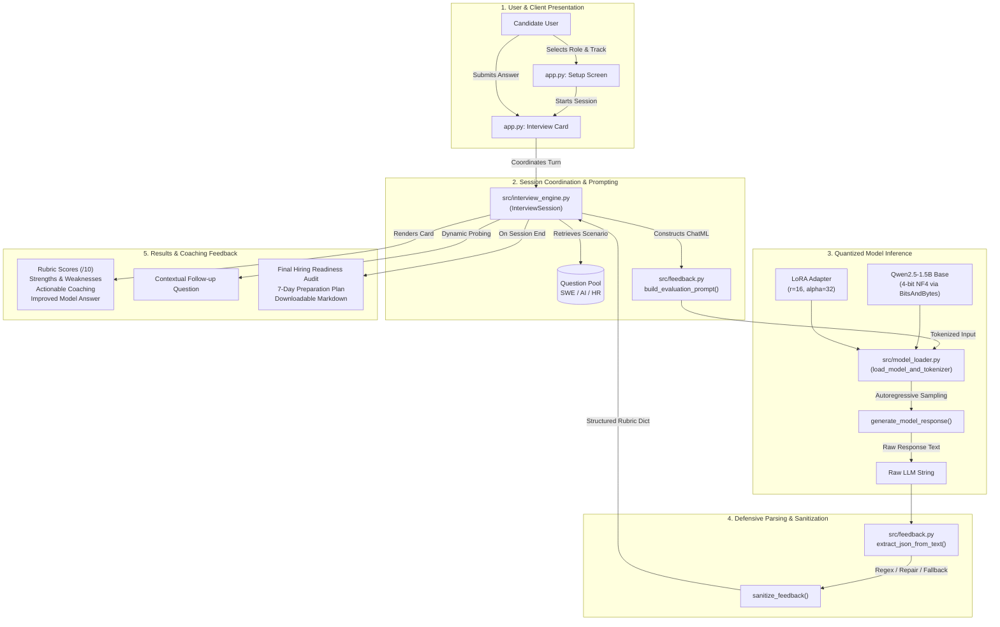

# 🎓 InterviewMate — AI Mock Interviewer

> **Deep Learning Capstone Project | Course 24ADI006**  
> An open-weight Transformer language model (`Qwen2.5-1.5B-Instruct`) specialized via **4-bit QLoRA** parameter-efficient fine-tuning on Google Colab free tier GPU resources, paired with a defensive 4-pillar rubric evaluation engine and an interactive Gradio web application.

---

## 👨‍🎓 Student & Course Information

| Parameter | Details |
| :--- | :--- |
| **Course Code** | **24ADI006** |
| **Course Name** | **Deep Learning** |
| **Student Name** | **jeevaaanantham** |
| **Roll Number** | **24BAD047** |
| **Project Title** | **InterviewMate – AI Mock Interviewer** |
| **Project Category** | **Project Based** |
| **Primary Course Outcome** | **CO5** (Attention Architectures & Advanced Language Models) |
| **Supporting Course Outcomes** | **CO1** (Optimization & Regularization) and **CO3** (Sequential NLP) |
| **GitHub Repository** | [https://github.com/jeevaa006/InterviewMate](https://github.com/jeevaa006/InterviewMate) |
| **Individual Video Explanation** | `PENDING — Add the final shareable video URL` *(See instructions below)* |

### 📚 Quick Documentation Links for Faculty Evaluation
- 🎯 **[Course Outcome (CO) Mapping Document](docs/CO_MAPPING.md)** — Comprehensive CO1–CO5 alignment analysis, justifications, and codebase evidence.
- 📹 **[Video Walkthrough & Presentation Script](docs/VIDEO_EXPLANATION.md)** — Individual presentation timestamps, detailed script, and video link submission instructions.
- 📘 **[Comprehensive Academic Project Report](docs/PROJECT_REPORT.md)** — Complete project report including theoretical background, architecture, experimental framework, and references.

> [!IMPORTANT]
> **Video Submission Link Placeholder:**  
> The video walkthrough link is currently:  
> `PENDING — Add the final shareable video URL`  
> To complete video submission: record the 5–7 minute walkthrough following [docs/VIDEO_EXPLANATION.md](docs/VIDEO_EXPLANATION.md), upload as an *Unlisted YouTube Video* or *Shareable Google Drive Link*, and update this field and [docs/VIDEO_EXPLANATION.md](docs/VIDEO_EXPLANATION.md).

---

## 📑 Table of Contents

1. [Project Overview](#-project-overview)
2. [Technology Stack](#-technology-stack)
3. [System Architecture & Workflow](#-system-architecture--workflow)
4. [Course Outcome (CO) Mapping (Course 24ADI006)](#-course-outcome-co-mapping-course-24adi006)
5. [Pretrained Model Selection & Rationale](#-pretrained-model-selection--rationale)
6. [Dataset Creation & Zero Data Leakage](#-dataset-creation--zero-data-leakage)
7. [Fine-Tuning Methodology (LoRA & QLoRA)](#-fine-tuning-methodology-lora--qlora)
8. [Defensive Parsing & Rubric Engine](#-defensive-parsing--rubric-engine)
9. [Interactive Web Application Features](#-interactive-web-application-features)
10. [Step-by-Step Google Colab Deployment Guide](#-step-by-step-google-colab-deployment-guide)
11. [Local Development & Automated Testing](#-local-development--automated-testing)
12. [Repository Directory Structure](#-repository-directory-structure)
13. [Limitations, Attribution & References](#-limitations-attribution--references)
14. [College Presentation & Viva Q&A Guide](#-college-presentation--viva-qa-guide)

---

## 🌟 Project Overview

### Problem Statement
Technical and behavioural interview coaching is vital for students transitioning into engineering careers. However, traditional interview practice suffers from critical bottlenecks:
- **High Financial Cost:** Professional mock interview platforms charge steep fees per session.
- **Dependency on Closed APIs:** Existing automated interview bots rely heavily on proprietary cloud APIs (e.g., OpenAI GPT-4, Anthropic Claude), introducing recurring token expenses, network latency, and privacy vulnerabilities.
- **Formatting & Scoring Inconsistency:** Off-the-shelf small language models without specialized fine-tuning suffer from prompt drift, hallucinated scoring, and syntax breakage when asked to produce structured feedback.

### Proposed Solution: InterviewMate
InterviewMate implements a self-contained, open-weight AI mock interviewer engineered for educational and practical preparation:
- **Open-Weight Transformer:** Employs [`Qwen/Qwen2.5-1.5B-Instruct`](https://huggingface.co/Qwen/Qwen2.5-1.5B-Instruct) (Apache 2.0 license), requiring zero proprietary API keys.
- **4-Bit QLoRA Fine-Tuning:** Efficiently adapts low-rank attention and MLP projection matrices on a free Google Colab Tesla T4 GPU in ~15 minutes.
- **Multi-Pillar Rubric Scoring:** Calibrates evaluations against four distinct criteria: Relevance, Technical Depth, Clarity & Structure, and Completeness.
- **Defensive Engineering:** Protects against LLM output format irregularities via a 4-tier JSON extraction and repair parser, ensuring the application never crashes during live use.
- **Target Users & Benefits:** Tailored for undergraduate engineering students, job seekers, and faculty evaluators seeking repeatable, objective technical interview practice.

---

## 💻 Technology Stack

| Layer | Component / Technology | Specification & Purpose |
| :--- | :--- | :--- |
| **Language & Runtime** | Python 3.10+ / Linux | Primary programming language and execution environment |
| **Base Language Model** | `Qwen/Qwen2.5-1.5B-Instruct` | 1.54B parameter decoder-only Transformer with Apache 2.0 License |
| **Attention Mechanism** | Multi-Head Self-Attention + GQA | Scaled dot-product attention with Grouped-Query Attention & RoPE |
| **Model Quantization** | `bitsandbytes` (NF4) | 4-bit NormalFloat Quantization + Double Quantization (~1.2 GB base VRAM) |
| **PEFT Adapter** | Hugging Face `peft` | Low-Rank Adaptation (LoRA: $r=16, \alpha=32$) targeting all linear projections |
| **Optimization & Training** | Hugging Face `trl` (`SFTTrainer`) | Paged AdamW 8-bit optimizer, Cosine Annealing learning rate scheduler |
| **Cloud Environment** | Google Colab (Tesla T4 GPU) | Free-tier cloud accelerator with 15 GB GDDR6 VRAM |
| **Interactive Interface** | Gradio Blocks 4.x | Web-based reactive user interface with temporary public cloud URL sharing |
| **Data Serialization** | JSONLines (`.jsonl`) / Pydantic | Structured record schema and evaluation datasets |
| **Testing & Verification** | Python `unittest` | 12 automated unit and integration tests covering dataset, fallbacks, and engine |

---

## 📐 System Architecture & Workflow

InterviewMate executes through a clean linear workflow connecting the user interface to the quantized language model and defensive rubric parser:

$$\text{User} \longrightarrow \text{Gradio Interface} \longrightarrow \text{Interview Engine} \longrightarrow \text{Model Loader (4-bit + LoRA)} \longrightarrow \text{Feedback & Rubric Parser} \longrightarrow \text{Results Display}$$



---

## 🎯 Course Outcome (CO) Mapping (Course 24ADI006)

This project has been aligned with the official course outcomes for **24ADI006 – Deep Learning**:

| Course Outcome | Syllabus Definition | Project Alignment | Technical Justification & Repository Evidence |
| :--- | :--- | :--- | :--- |
| **CO1** | *Apply neural network architectures, activation functions, optimization methods, and regularization techniques to develop and evaluate deep learning models for predictive tasks.* | **Supporting Mapping** | Implements **Paged AdamW 8-bit** optimizer, **Cosine Annealing** learning rate scheduling with warmup, LoRA dropout regularization ($p=0.05$), cross-entropy causal language modeling loss, and rubric predictive **Mean Absolute Error (MAE)** evaluation on held-out samples. Verified in [`colab/InterviewMate_Training_and_Demo.ipynb`](colab/InterviewMate_Training_and_Demo.ipynb#L18) and [`src/evaluation.py`](src/evaluation.py#L9-L12). |
| **CO2** | *Implement deep learning techniques for feature extraction, image analysis, and computer vision applications.* | **Not Directly Mapped** | InterviewMate focuses strictly on Natural Language Processing (NLP) dialogs and interview transcripts. It does not utilize convolutional networks, vision transformers, or image feature extraction pipelines. |
| **CO3** | *Develop sequential learning models for processing and analyzing sequential and natural language data.* | **Supporting Mapping** | Implements sequential tokenization, Rotary Position Embeddings (RoPE), and causal autoregressive language generation. Demonstrates the modern evolution of sequential modeling from recurrent neural networks (RNNs/LSTMs) to causal self-attention decoders. Verified in [`src/feedback.py`](src/feedback.py#L29-L81) and [`src/model_loader.py`](src/model_loader.py#L95-L112). |
| **CO4** | *Analyze generative and unsupervised deep learning techniques for representation learning, feature extraction, and synthetic data generation.* | **Contextual / Related Connection** | Generates novel candidate feedback and follow-up inquiries autoregressively, and implements a rule-based synthetic dataset generator. However, generating text using an instruction-tuned decoder **does not** constitute implementation of Variational Autoencoders (VAEs), Generative Adversarial Networks (GANs), or diffusion models. |
| **CO5** | *Analyze attention-based architectures and advanced deep learning techniques to develop intelligent applications for language and multimodal AI tasks.* | **Primary Mapping** | Implements and fine-tunes a modern Transformer decoder (`Qwen2.5-1.5B-Instruct`) utilizing **Scaled Dot-Product Multi-Head Attention**, **Grouped-Query Attention (GQA)**, and **Rotary Position Embeddings (RoPE)**. Applies advanced parameter-efficient deep learning (**4-bit QLoRA**) and deploys a real-time language application. Verified in [`src/model_loader.py`](src/model_loader.py#L62-L131) and [`app.py`](app.py#L50-L60). |

> [!NOTE]
> **Academic Integrity & Faculty Assessment Notice:**  
> The mappings above reflect self-contained, project-level technical alignments with course concepts, not an official faculty-approved grade or certification. For detailed mathematical formulations and syllabus topic dissections, consult [docs/CO_MAPPING.md](docs/CO_MAPPING.md).

---

## 🧠 Pretrained Model Selection & Rationale

We evaluated candidate open-weight language models for this project:

| Candidate Model | Parameters | License | FP16 VRAM | 4-bit QLoRA VRAM | Colab T4 Feasibility | Project Verdict |
| :--- | :--- | :--- | :--- | :--- | :--- | :--- |
| **`Qwen/Qwen2.5-1.5B-Instruct`** | **1.54B** | **Apache 2.0** | **~3.2 GB** | **~1.2 GB** | **Yes (Flawless)** | **SELECTED (Optimal Balance)** |
| `Qwen/Qwen2.5-0.5B-Instruct` | 0.49B | Apache 2.0 | ~1.1 GB | ~0.6 GB | Yes (Ultra-light) | Fallback candidate |
| `Qwen/Qwen3-1.7B` | 1.7B | Apache 2.0 | ~3.6 GB | ~1.5 GB | Yes | High performance alternate |
| `Meta-Llama-3.1-8B-Instruct` | 8.03B | Llama Community | ~16.5 GB | ~6.5 GB | High OOM Risk | VRAM-heavy; gated access |

### Why `Qwen/Qwen2.5-1.5B-Instruct` was selected:
1. **Permissive Apache 2.0 Licensing:** Unrestricted open-source usage with zero commercial gating or proprietary API keys.
2. **Superior JSON & Reasoning Compliance:** Instruction-tuned specifically on synthetic data, code, and structured reasoning.
3. **Hardware Economics on Free Colab:** The base weights occupy only **~1.2 GB in 4-bit precision**. When training with LoRA adapters ($r=16$), peak memory usage remains under **~6 GB**, well below Google Colab's 15 GB ceiling.
4. **Context Length:** Supports up to 32,768 tokens via RoPE, ensuring long multi-turn interview histories fit comfortably.

---

## 📊 Dataset Creation & Zero Data Leakage

To ensure academic rigor with zero paid API usage, we developed an original synthetic dataset generator in [`scripts/generate_dataset.py`](scripts/generate_dataset.py).

### 1. Dataset Breakdown (156 Total Records)
- 💻 **Software Development (60 records / 20 scenarios):** B+ tree indexing, concurrency & race conditions, REST vs GraphQL, CAP theorem, CI/CD pipelines, Redis caching, Docker vs VMs, system design, Core Web Vitals, ACID isolation.
- 🤖 **AI & Data Science (57 records / 19 scenarios):** Overfitting & regularization, self-attention mechanics, evaluation under class imbalance, LoRA & QLoRA mechanics, bias-variance tradeoff, RAG vs fine-tuning, vector embeddings, gradient vanishing, data drift.
- 🤝 **HR & Behavioural (39 records / 13 scenarios):** STAR method (Situation, Task, Action, Result) responses covering technical disagreements, failure ownership, competing deadlines, leading without authority, and ethical dilemmas.

### 2. Tri-Tier Answer Profiles
Every scenario includes three distinct answer variants:
- **Weak:** Contains factual misconceptions, vague buzzwords, or missing structure.
- **Average:** Factually correct on fundamentals, but misses production trade-offs or quantitative depth.
- **Strong:** Exemplary response analyzing algorithmic complexity, edge cases, and architectural trade-offs.

### 3. Scenario-Level Partitioning (Zero Data Leakage)
To prevent data contamination, we partition data by **question scenario prefix**, ensuring all weak, average, and strong variants of a scenario remain strictly together:
- **Training Set ([`data/interview_train.jsonl`](data/interview_train.jsonl)):** 123 records (41 scenarios, ~80%).
- **Evaluation Set ([`data/interview_eval.jsonl`](data/interview_eval.jsonl)):** 33 records (11 scenarios, ~20%).
- Verified by automated unit test `test_zero_data_leakage` in [`tests/test_interviewmate.py`](tests/test_interviewmate.py).

---

## ⚡ Fine-Tuning Methodology (LoRA & QLoRA)

### Mathematical Foundations
1. **Low-Rank Adaptation (LoRA):** Parameter updates $\Delta W$ for base weight matrix $W_0 \in \mathbb{R}^{d \times k}$ are constrained to a low-rank decomposition:
   $$\Delta W = \frac{\alpha}{r} (B \cdot A)$$
   where $B \in \mathbb{R}^{d \times r}$ is initialized to zero, $A \in \mathbb{R}^{r \times k}$ is initialized with Gaussian noise, and rank $r=16, \alpha=32$.
2. **NormalFloat4 (NF4) Quantization:** Quantizes weights to an information-theoretically optimal distribution for normally distributed neural network tensors.
3. **Double Quantization (DQ):** Quantizes the first-stage quantization constants, saving ~0.37 bits per parameter.
4. **Paged AdamW 8-bit:** Automatically pages memory pages to host RAM during backward-pass allocation spikes.

### Memory Comparison on Colab T4 GPU
| Method | Base Model Weights | Trainable Parameters | Optimizer Memory | Colab T4 Feasibility |
| :--- | :--- | :--- | :--- | :--- |
| **Full Fine-Tuning** | FP16 (~3.2 GB) | 100% (1.54B params) | ~12.3 GB (FP32 states) | ❌ Out of Memory (OOM) |
| **Standard LoRA** | FP16 (~3.2 GB) | ~0.8% (~12M params) | ~0.1 GB | ⚠️ Tight VRAM headroom |
| **QLoRA (Ours)** | **NF4 (~1.2 GB)** | **~0.8% (~12M params)** | **~0.1 GB (Paged 8-bit)** | **✅ Ideal (~4.8 to 5.6 GB Peak)** |

---

## 🛡️ Defensive Parsing & Rubric Engine

Small language models occasionally produce markdown code blocks or conversational commentary alongside JSON. [`src/feedback.py`](src/feedback.py) implements a **4-tier defensive pipeline**:
1. **Direct JSON Parsing:** Attempts `json.loads(text.strip())`.
2. **Markdown Regex Extraction:** Extracts content encased within ```` ```(?:json)? ... ``` ````.
3. **Brace Substring & Comma Repair:** Slices outermost `{ ... }` and strips invalid trailing commas (`,\s*([\]}]) \to \1`).
4. **Deterministic Heuristic Fallback:** If the output is completely malformed, extracts numbers via regex, clamps scores to $[1, 10]$, and constructs a safe feedback dictionary. **The web app never crashes or hangs.**

---

## 💻 Interactive Web Application Features

The Gradio Blocks interface in [`app.py`](app.py) provides:
1. **Interview Customization:** Choose role (Backend, Frontend, Fullstack, AI/Data Science, DevOps), seniority (Junior, Mid, Senior), track, and question count.
2. **Question-by-Question Progression:** Distraction-free, focused single-question display.
3. **4-Pillar Score Cards:**
   - **Relevance (/10)**
   - **Technical Depth & Correctness (/10)**
   - **Clarity & Structure (/10)**
   - **Completeness (/10)**
4. **Actionable Coaching:** Bulleted strengths, weaknesses, and a refined model answer.
5. **Contextual Follow-up Engine:** Probing questions tailored directly to the candidate's specific previous answer.
6. **Hiring Readiness Audit:** Comprehensive final report with readiness classification and a **7-day preparation roadmap**.
7. **Downloadable Markdown Report:** Complete interview transcript and rubric breakdown export.

---

## 🚀 Step-by-Step Google Colab Deployment Guide

Follow these steps to fine-tune the model and launch the live web application on Google Colab:

### Step 1: Open Google Colab
1. Navigate to [https://colab.research.google.com](https://colab.research.google.com).
2. Click **Upload** and upload [`colab/InterviewMate_Training_and_Demo.ipynb`](colab/InterviewMate_Training_and_Demo.ipynb).

### Step 2: Enable Free GPU Acceleration
1. In the top menu, navigate to **Runtime** > **Change runtime type**.
2. Under **Hardware accelerator**, select **T4 GPU**.
3. Click **Save**.

### Step 3: Run the Pipeline Cells
1. **Cells 1–2 (Hardware Check):** Verifies `nvidia-smi` detects the Tesla T4 GPU with ~15GB GDDR6 VRAM.
2. **Cell 3 (Install Dependencies):** Installs `transformers`, `peft`, `accelerate`, `bitsandbytes`, `trl`, and `gradio`.
3. **Cell 4 (Mount Google Drive):** *(Optional)* Persists the fine-tuned adapter weights to Google Drive.
4. **Cells 5–6 (Dataset Loading & ChatML Formatting):** Loads the 156 records and applies the conversation template.
5. **Cells 7–8 (QLoRA Setup & SFT Training):** Quantizes base model to 4-bit NF4, initializes LoRA adapters, and trains for 3 epochs using `SFTTrainer` (~12–18 minutes).
6. **Cell 9 (Save Adapter):** Exports `adapter_model.safetensors` to `./saved_adapter`.
7. **Cell 10 (Evaluation Benchmark):** Benchmarks rubric performance on held-out samples.
8. **Cell 11 (Launch Gradio):** Starts `app.py --share`.

### Step 4: Access the Live Web Demo
In the output of Cell 11, Gradio provides a temporary public link:
```text
Running on local URL: http://127.0.0.1:7860
Running on public URL: https://xxxxxxxx.gradio.live
```
Open the public URL in your browser to test the interactive mock interviewer live!

---

## 🧪 Local Development & Automated Testing

You can run the entire test suite locally without requiring a GPU or large model downloads. The built-in `MockModel` automatically activates when PyTorch or CUDA is absent.

```bash
# 1. Activate virtual environment (if using venv)
source venv/bin/activate

# 2. Run the automated test suite
python3 -m unittest discover -s tests -v
```

**Expected Test Output:**
```text
test_dataset_files_exist (test_interviewmate.TestDatasetIntegrity.test_dataset_files_exist) ... ok
test_schema_and_counts (test_interviewmate.TestDatasetIntegrity.test_schema_and_counts) ... ok
test_zero_data_leakage (test_interviewmate.TestDatasetIntegrity.test_zero_data_leakage) ... ok
test_evaluation_benchmark (test_interviewmate.TestEvaluationEngine.test_evaluation_benchmark) ... ok
test_broken_output_fallback_never_crashes (test_interviewmate.TestFeedbackAndJSONParser.test_broken_output_fallback_never_crashes) ... ok
test_clean_json_parsing (test_interviewmate.TestFeedbackAndJSONParser.test_clean_json_parsing) ... ok
test_markdown_code_fence_parsing (test_interviewmate.TestFeedbackAndJSONParser.test_markdown_code_fence_parsing) ... ok
test_score_boundary_clamping (test_interviewmate.TestFeedbackAndJSONParser.test_score_boundary_clamping) ... ok
test_trailing_comma_repair (test_interviewmate.TestFeedbackAndJSONParser.test_trailing_comma_repair) ... ok
test_session_lifecycle (test_interviewmate.TestInterviewEngine.test_session_lifecycle) ... ok
test_hardware_status_dict (test_interviewmate.TestModelLoaderAndHardware.test_hardware_status_dict) ... ok
test_model_loading_fallback (test_interviewmate.TestModelLoaderAndHardware.test_model_loading_fallback) ... ok

----------------------------------------------------------------------
Ran 12 tests in 0.061s

OK
```

To test the Gradio user interface locally in mock development mode:
```bash
python3 app.py --port 7860
```
Then navigate to `http://localhost:7860` in your web browser.

---

## 📂 Repository Directory Structure

```text
interviewmate/
├── app.py                                   # Gradio web application (Local & Cloud execution)
├── requirements.txt                         # Pinned, tested dependencies for Colab and local environments
├── .gitignore                               # Git exclusions (checkpoints, weights, venv, temporary cache)
├── README.md                                # Primary project overview, student metadata & viva guide
├── colab/
│   └── InterviewMate_Training_and_Demo.ipynb # Complete end-to-end Google Colab notebook
├── data/
│   ├── interview_train.jsonl                # 123 verified training records (41 scenarios)
│   └── interview_eval.jsonl                 # 33 held-out evaluation records (11 scenarios, zero leakage)
├── docs/
│   ├── CO_MAPPING.md                        # Formal Course Outcome (CO1-CO5) alignment document
│   ├── VIDEO_EXPLANATION.md                 # Presentation script, timeline (5-7 min) & video URL guide
│   └── PROJECT_REPORT.md                    # Comprehensive academic capstone project report
├── scripts/
│   ├── generate_dataset.py                  # Standalone synthetic dataset generator & validator
│   └── build_colab_notebook.py              # Automated builder for the Colab notebook JSON
├── src/
│   ├── __init__.py                          # Package identifier
│   ├── model_loader.py                      # 4-bit QLoRA & base model loader with CPU fallback
│   ├── interview_engine.py                  # Session progression, question bank & follow-ups
│   ├── feedback.py                          # Prompt builder, JSON repair parser & final report
│   └── evaluation.py                        # Base vs fine-tuned comparative benchmark
└── tests/
    └── test_interviewmate.py                # 12 automated unit and integration tests
```

---

## ⚖️ Limitations, Attribution & References

### Acknowledged Limitations
1. **Synthetically Generated Dataset:** The 156 records were generated using domain heuristics and rubrics. While structurally sound and validated, human calibration with professional interview transcripts will enhance nuance.
2. **Modality:** Currently evaluates written responses. Vocal tone, speech cadence, and visual presentation are not processed.
3. **Adapter Weights in Version Control:** Large binary weights (`.safetensors`) are intentionally omitted from GitHub per standard git hygiene. Adapters are generated during Colab execution and persisted to Google Drive.

### Attribution & References
- **Base Model:** [`Qwen/Qwen2.5-1.5B-Instruct`](https://huggingface.co/Qwen/Qwen2.5-1.5B-Instruct) licensed under the **Apache License 2.0**.
- **Transformer Architecture:** Vaswani et al., *"Attention Is All You Need"*, NeurIPS 2017.
- **LoRA:** Hu et al., *"LoRA: Low-Rank Adaptation of Large Language Models"*, 2021.
- **QLoRA:** Dettmers et al., *"QLoRA: Efficient Finetuning of Quantized LLMs"*, NeurIPS 2023.
- **Project Code License:** MIT License.

---

## 🎤 College Presentation & Viva Q&A Guide

#### Q1: "Why did you fine-tune an open-weight model instead of using prompt engineering on the base model?"
> **Answer:** "Prompt engineering alone on small 1.5B models frequently results in formatting drift, markdown leakage, and hallucinated scores. Fine-tuning with LoRA adapts the model's internal representation to consistently adhere to our 4-pillar scoring rubric, calibrate score distributions, and reliably output structured JSON with zero extra prompt overhead."

#### Q2: "What is the difference between LoRA and QLoRA?"
> **Answer:** "LoRA freezes the base model weights and trains low-rank decomposition matrices ($B \cdot A$) while keeping base weights in 16-bit floating point (~3.2 GB). QLoRA quantizes the frozen base weights down to 4-bit NormalFloat (NF4), reducing base model memory to ~1.2 GB, and introduces Double Quantization and Paged Optimizers. This enables fine-tuning on consumer-tier cloud GPUs like the Colab T4."

#### Q3: "What prevents the model from leaking answers between training and testing?"
> **Answer:** "We implemented scenario-level group partitioning in `scripts/generate_dataset.py`. All three quality variations (weak, average, strong) of a question scenario are strictly kept together. The evaluation set consists of 33 records from 11 scenarios that the model never encountered during training, verified by automated unit tests."

#### Q4: "What happens if the model produces malformed output or invalid JSON?"
> **Answer:** "We implemented defensive engineering in `src/feedback.py`. The parser uses a multi-tier extraction pipeline: direct parsing, markdown code-fence regex extraction, and trailing-comma repair. If the output is completely malformed, a deterministic heuristic fallback scores the answer and populates the rubric, guaranteeing that the web application never crashes in production."

#### Q5: "How does this project address Course Outcome 5 (CO5) of Deep Learning?"
> **Answer:** "CO5 focuses on attention-based architectures and advanced deep learning techniques for intelligent language applications. InterviewMate directly implements a Transformer decoder utilizing Multi-Head Self-Attention, Grouped-Query Attention, and Rotary Position Embeddings, applies advanced parameter-efficient QLoRA fine-tuning, and packages the model into a real-time conversational interview application."
