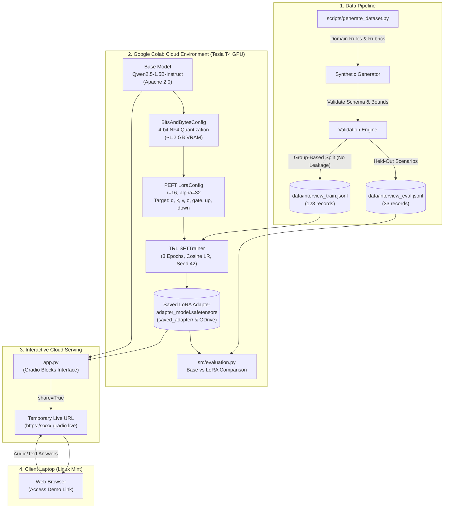

# 🎓 InterviewMate — Interview-Specialized AI Model & Mock Interviewer

> **A Complete College Capstone Project**  
> Fine-tuned Open-Weight Language Model (`Qwen2.5-1.5B-Instruct`) using **4-bit QLoRA** on Google Colab free tier resources, paired with a structured rubric scoring engine and an interactive Gradio web application.

---

## 📑 Table of Contents
1. [Project Overview](#-project-overview)
2. [System Architecture](#-system-architecture)
3. [Pretrained Model Selection & Rationale](#-pretrained-model-selection--rationale)
4. [Dataset Creation & Validation](#-dataset-creation--validation)
5. [Fine-Tuning Methodology (LoRA / QLoRA)](#-fine-tuning-methodology-lora--qlora)
6. [Interactive Mock Interview Application](#-interactive-mock-interview-application)
7. [Step-by-Step Google Colab Cloud Deployment Guide](#-step-by-step-google-colab-cloud-deployment-guide)
8. [College Presentation & Viva Q&A Guide](#-college-presentation--viva-qa-guide)
9. [Project File Structure](#-project-file-structure)
10. [Local Development & Testing](#-local-development--testing)
11. [License & Ethical Notice](#-license--ethical-notice)

---

## 🌟 Project Overview

**InterviewMate** solves a critical problem for students and aspiring engineers: the lack of accessible, personalized, and domain-specialized mock interview coaching. 

Instead of relying on costly proprietary APIs (such as OpenAI or Anthropic) or attempting the impossible task of training a foundation model from scratch, InterviewMate takes a modern engineering approach:
- We select an open-weight foundation model (**Qwen2.5-1.5B-Instruct**).
- We construct an original, expert-rubric synthetic dataset covering **Software Engineering**, **AI & Data Science**, and **HR & Behavioural (STAR method)** interviews.
- We fine-tune the model using **QLoRA (4-bit NormalFloat Quantization + Low-Rank Adaptation)** on free cloud GPUs (**Google Colab Tesla T4**).
- We serve the application via **Gradio** in the cloud, generating a temporary public URL for live demonstrations without requiring any expensive local GPU.

---

## 📐 System Architecture



---

## 🧠 Pretrained Model Selection & Rationale

We evaluated candidate open-weight language models for this capstone project:

| Candidate Model | Parameters | License | FP16 VRAM | 4-bit QLoRA VRAM | Colab T4 Compatible? | Evaluation Verdict |
| :--- | :--- | :--- | :--- | :--- | :--- | :--- |
| **Qwen/Qwen2.5-1.5B-Instruct** | **1.54B** | **Apache 2.0** | **~3.2 GB** | **~1.2 GB** | **Yes (Flawless)** | **SELECTED (Optimal Balance)** |
| `Qwen/Qwen3-1.7B` | 1.7B | Apache 2.0 | ~3.6 GB | ~1.5 GB | Yes | High performance, alternative drop-in |
| `Qwen/Qwen2.5-0.5B-Instruct` | 0.49B | Apache 2.0 | ~1.1 GB | ~0.6 GB | Yes (Ultra-light) | Fallback for constrained setups |
| `Meta-Llama-3.1-8B-Instruct` | 8.03B | Llama 3.1 Community | ~16.5 GB | ~6.5 GB | Tight (OOM risk) | High VRAM; restricted license gating |

### Why `Qwen/Qwen2.5-1.5B-Instruct` was selected:
1. **Permissive Apache 2.0 License:** Completely open-source for academic and commercial use, with zero gating forms or restricted approvals.
2. **Exceptional Structured JSON Compliance:** Qwen2.5 models are specifically pre-trained and instruction-tuned on structured output, code, and reasoning tasks, making them resilient at producing valid JSON without syntax breakage.
3. **Hardware Economics on Free Colab:** The base weights occupy only **1.2 GB in 4-bit precision**. When training with LoRA adapters ($r=16$) and gradient checkpointing, total VRAM consumption peaks at only **~4.5 to 6 GB**, leaving abundant headroom on Google Colab's 15 GB Tesla T4 GPU.
4. **Context Window:** Native support for long context (up to 32,768 tokens) ensures complete conversation history and follow-up chains fit without truncation.

---

## 📊 Dataset Creation & Validation

To respect the constraint of zero paid APIs and zero pre-existing data, we constructed an original, rule-based synthetic dataset generator in [scripts/generate_dataset.py](file:///home/jeevaa/projects/interviewmate/scripts/generate_dataset.py).

### 1. Dataset Taxonomy (156 Records Total)
- **Domain Categories:**
  - 💻 **Software Development (60 records):** Databases & indexing, concurrency & race conditions, REST vs GraphQL, CAP theorem, CI/CD, Redis caching, Docker vs VMs, system design, OWASP security, Web Vitals, ACID isolation.
  - 🤖 **AI & Data Science (57 records):** Overfitting & regularization, self-attention mathematics, evaluation metrics under class imbalance, LoRA & QLoRA mechanics, bias-variance tradeoff, RAG vs fine-tuning, embeddings & vector search, gradient vanishing, drift detection.
  - 🤝 **HR & Behavioural (39 records):** STAR method (Situation, Task, Action, Result) responses covering technical disagreements, ownership of mistakes, competing deadlines, leading without authority, ethical dilemmas, and receiving critical feedback.

### 2. Tri-Tier Answer Profiles
Every interview scenario includes three distinct answer qualities:
1. **Weak Answer:** Contains factual misconceptions, vague buzzwords, or defensive/unstructured communication.
2. **Average Answer:** Factually correct on fundamentals, but misses production trade-offs, quantitative metrics, or deeper failure modes.
3. **Strong Answer:** Masterful explanation highlighting algorithmic complexity, architectural trade-offs, edge-case mitigation, or articulate STAR narratives.

### 3. Record Schema
Each record is validated against strict constraints:
```json
{
  "id": "SWE_IDX_WEAK",
  "category": "software_development",
  "role": "Backend Engineer",
  "experience_level": "Mid-Level",
  "instruction": "Evaluate the candidate's interview answer according to the rubric...",
  "interview_question": "How do database indexes improve query performance...",
  "candidate_answer": "Indexes make queries fast because they sort data in a table...",
  "answer_quality": "weak",
  "scoring_rubric": {
    "relevance": 6,
    "accuracy_depth": 3,
    "clarity_structure": 5,
    "completeness": 3
  },
  "overall_score": 4,
  "strengths": ["Recognizes that indexes exist to speed up search queries."],
  "weaknesses": ["Suggesting an index on every column is a critical anti-pattern..."],
  "actionable_feedback": ["Explain B+ Tree lookups (O(log N) vs O(N))..."],
  "improved_sample_answer": "Database indexes improve query performance by constructing auxiliary B+ Trees...",
  "follow_up_question": "What is the difference between a clustered and non-clustered index?"
}
```

### 4. Zero Data Leakage Guarantee
We split scenarios using **group-based partitioning** (80% train / 20% eval). All weak, average, and strong variants of a given scenario remain strictly grouped together:
- **`data/interview_train.jsonl`:** 123 records across 41 scenarios.
- **`data/interview_eval.jsonl`:** 33 records across 11 scenarios (100% held-out).

> [!NOTE]
> **Ethical Notice on Synthetic Data:**  
> This dataset was generated synthetically using domain heuristics and expert rubrics for educational purposes. Synthetic data may reflect prompt biases or simplifications and requires human validation before clinical, legal, or high-stakes employment decisions.

---

## ⚡ Fine-Tuning Methodology (LoRA / QLoRA)

### Full Fine-Tuning vs. LoRA vs. QLoRA

| Method | Base Model Weights | Trainable Parameters | Optimizer Memory (AdamW) | Colab T4 Feasibility |
| :--- | :--- | :--- | :--- | :--- |
| **Full Fine-Tuning** | FP16 (3.2 GB) | 100% (1.54B params) | ~12.3 GB (FP32 states) | ❌ Out of Memory (OOM) |
| **LoRA** | FP16 (3.2 GB) | ~0.8% (~12M params) | ~0.1 GB | ⚠️ Feasible but higher VRAM |
| **QLoRA (Ours)** | **NF4 (1.2 GB)** | **~0.8% (~12M params)** | **~0.1 GB (Paged 8-bit)** | **✅ Ideal (~4.5 GB Peak VRAM)** |

### Mathematical Principles of LoRA & QLoRA
1. **Low-Rank Decomposition:** Weight updates $\Delta W$ for a weight matrix $W_0 \in \mathbb{R}^{d \times k}$ are decomposed into two low-rank matrices:
   $$\Delta W = \frac{\alpha}{r} (B \cdot A)$$
   where $B \in \mathbb{R}^{d \times r}$ is initialized to zeros, $A \in \mathbb{R}^{r \times k}$ is initialized with Gaussian noise, and rank $r \ll \min(d, k)$ (we use $r=16, \alpha=32$).
2. **NormalFloat4 (NF4) Quantization:** An information-theoretically optimal non-linear quantization data type designed for normally distributed neural network weights.
3. **Double Quantization (DQ):** Quantizes the quantization constants themselves, reducing memory footprint by an additional 0.37 bits per parameter.
4. **Paged Optimizers:** Uses CUDA unified memory to dynamically page memory between GPU VRAM and CPU RAM during gradient checkpointing spikes, eliminating unexpected OOM crashes.

---

## 💻 Interactive Mock Interview Application

The web interface is built with **Gradio Blocks** in [app.py](file:///home/jeevaa/projects/interviewmate/app.py) and features:

1. **Custom Session Configuration:** Select Target Role, Experience Level (Junior, Mid, Senior), Interview Mode (Software Dev, AI, Behavioural), and Question Count.
2. **One Question at a Time:** Clean, distraction-free interface presenting one question per step.
3. **Real-time 4-Pillar Rubric Scoring:**
   - **Relevance (/10)**
   - **Technical Depth & Correctness (/10)**
   - **Clarity & Structure (/10)**
   - **Completeness (/10)**
4. **Actionable Coaching:** Immediate breakdown of strengths, weaknesses, coaching advice, and an exemplary improved sample answer.
5. **Contextual Follow-Up Engine:** The model generates targeted follow-up inquiries that dig into the candidate's specific answer.
6. **Comprehensive Final Performance Audit:** A consolidated report with average scores, hiring readiness tier, and a personalized **7-day preparation roadmap**.
7. **Downloadable Markdown Report:** Candidate can export the entire interview transcript and feedback log.

---

## 🚀 Step-by-Step Google Colab Cloud Deployment Guide

Follow these steps to run the fine-tuning and launch the live web demo:

### Step 1: Open Google Colab
1. Open your web browser on Linux Mint and navigate to [https://colab.research.google.com](https://colab.research.google.com).
2. Click **Upload** and upload [InterviewMate_Training_and_Demo.ipynb](file:///home/jeevaa/projects/interviewmate/colab/InterviewMate_Training_and_Demo.ipynb).

### Step 2: Enable Free GPU Acceleration
1. In the top menu, go to **Runtime** > **Change runtime type**.
2. Under **Hardware accelerator**, select **T4 GPU**.
3. Click **Save**.

### Step 3: Run the Cells
1. **Cell 1 & 2 (Hardware Check):** Verifies that `nvidia-smi` detects the Tesla T4 GPU with ~15GB of GDDR6 VRAM.
2. **Cell 3 (Dependencies):** Automatically installs `transformers`, `peft`, `accelerate`, `bitsandbytes`, `trl`, and `gradio`.
3. **Cell 4 (Mount Google Drive):** *(Optional)* Connect your Google Drive so the trained LoRA adapter is permanently backed up.
4. **Cell 5 & 6 (Dataset & Formatting):** Loads and verifies the 156 records and applies the ChatML template.
5. **Cell 7 & 8 (Model Loading & QLoRA Fine-Tuning):**
   - Quantizes `Qwen2.5-1.5B-Instruct` to 4-bit NF4.
   - Attaches LoRA adapters to attention and MLP layers.
   - Trains for 3 epochs with `SFTTrainer`. Training typically completes in **~12 to 18 minutes** on free Colab!
6. **Cell 9 (Save Adapter):** Exports `adapter_model.safetensors` and `adapter_config.json` into `./saved_adapter`.
7. **Cell 10 (Evaluation Benchmark):** Benchmarks the base model against the fine-tuned adapter on held-out samples.
8. **Cell 11 (Launch Gradio):** Executes `app.py --share`.

### Step 4: Open Your Demonstration Link
In the output of Cell 11, Gradio prints:
```text
Running on local URL: http://127.0.0.1:7860
Running on public URL: https://3b9a1c2d.gradio.live
```
Click the **public URL (`.gradio.live`)** to open the live web application on your Linux Mint laptop or share it with your college evaluation panel!

> [!IMPORTANT]
> **Colab Session Lifespan:**  
> The temporary `.gradio.live` link remains active as long as the Google Colab session is running. If your Colab tab is closed or idle for over 60–90 minutes, Colab disconnects and the public link expires. To restart, simply rerun Cell 11!

---

## 🎤 College Presentation & Viva Q&A Guide

Be prepared to answer these common questions from your professor or external examiner:

#### Q1: "Why did you fine-tune a model instead of using prompt engineering on the base model?"
> **Answer:** "Prompt engineering alone on small 1.5B models frequently results in formatting drift, inconsistent JSON structures, and hallucinated scores. Fine-tuning with LoRA adapts the model's internal representation to consistently adhere to our 4-pillar scoring rubric, calibrate score distributions, and reliably output structured JSON with zero extra prompt overhead."

#### Q2: "What is the difference between LoRA and QLoRA?"
> **Answer:** "LoRA freezes the base model weights and trains low-rank decomposition matrices ($B \cdot A$). However, the base weights are still kept in 16-bit floating point (~3.2 GB). QLoRA quantizes the frozen base weights down to 4-bit NormalFloat (NF4), reducing base model memory to ~1.2 GB, and introduces Double Quantization and Paged Optimizers. This allows us to fine-tune on free consumer GPUs like the Colab T4."

#### Q3: "What prevents the model from leaking answers between training and testing?"
> **Answer:** "We used scenario-level group partitioning. In [scripts/generate_dataset.py](file:///home/jeevaa/projects/interviewmate/scripts/generate_dataset.py), all three quality variations (weak, average, strong) of a question scenario are strictly kept together. The evaluation set consists of 33 records from 11 scenarios that the model never encountered during training."

#### Q4: "What happens if the model produces malformed output or invalid JSON?"
> **Answer:** "We implemented defensive engineering in [src/feedback.py](file:///home/jeevaa/projects/interviewmate/src/feedback.py). The parser uses a multi-tier extraction pipeline: direct parsing, markdown code-fence regex extraction, and trailing-comma repair. If the output is completely malformed, a deterministic heuristic fallback scores the answer and populates the rubric, guaranteeing that the web application never crashes or hangs in production."

---

## 📂 Project File Structure

```text
interviewmate/
├── app.py                                   # Gradio web application (Local & Cloud execution)
├── requirements.txt                         # Pinned, tested cloud and local dependencies
├── .gitignore                               # Git exclusions (checkpoints, venv, cache)
├── README.md                                # Comprehensive capstone documentation & viva guide
├── colab/
│   └── InterviewMate_Training_and_Demo.ipynb # Complete end-to-end Google Colab notebook
├── data/
│   ├── interview_train.jsonl                # 123 verified training records (41 scenarios)
│   └── interview_eval.jsonl                 # 33 held-out evaluation records (11 scenarios)
├── scripts/
│   ├── generate_dataset.py                  # Standalone synthetic dataset generator & validator
│   └── build_colab_notebook.py              # Automated builder for the Colab notebook JSON
├── src/
│   ├── __init__.py                          # Package identifier
│   ├── model_loader.py                      # 4-bit QLoRA & base model loader with CPU fallback
│   ├── interview_engine.py                  # Session progression, question bank & follow-ups
│   ├── feedback.py                          # Prompt builder, JSON repair parser & final report
│   └── evaluation.py                        # Base vs fine-tuned comparative benchmark
└── tests/
    └── test_interviewmate.py                # 12 automated unit and integration tests
```

---

## 🧪 Local Development & Testing

You can run the entire test suite locally on your Linux Mint laptop without needing a GPU:

```bash
# 1. Activate your Python virtual environment
source venv/bin/activate

# 2. Run the test suite
python tests/test_interviewmate.py
```
**Expected Output:**
```text
----------------------------------------------------------------------
Ran 12 tests in 0.026s

OK
```

To test the Gradio user interface locally in mock development mode:
```bash
python app.py --port 7860
```
Open `http://localhost:7860` in your web browser.

---

## ⚖️ License & Ethical Notice

- **Base Model License:** [Qwen 2.5](https://huggingface.co/Qwen/Qwen2.5-1.5B-Instruct) is released under the **Apache License 2.0**.
- **Project Code:** Released under the **MIT License**.
- **Usage Disclaimer:** InterviewMate is developed for educational and experimental preparation purposes. It does not replace human hiring committees or professional career counselling.
