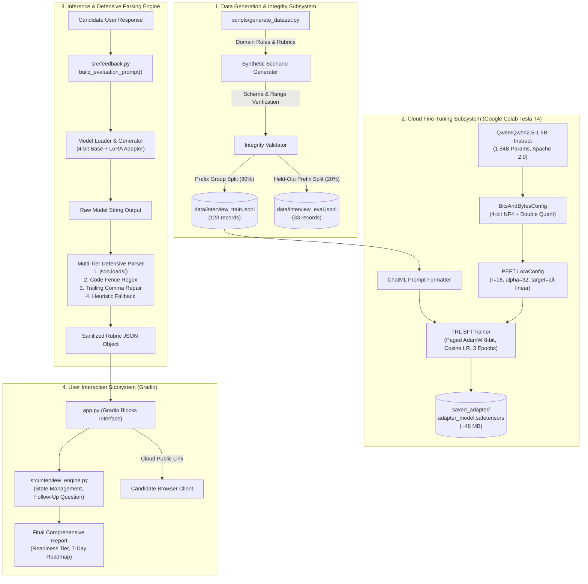

# 📘 InterviewMate: AI Mock Interviewer – Academic Project Report

**Course Code:** 24ADI006  
**Course Name:** Deep Learning  
**Project Title:** InterviewMate – AI Mock Interviewer  
**Project Category:** Project Based  
**Student Name:** jeevaanantham  
**Roll Number:** 24BAD047  
**Academic Year:** 2026–2027  
**GitHub Repository:** [https://github.com/jeevaa006/InterviewMate](https://github.com/jeevaa006/InterviewMate)  
**Primary Course Outcome:** **CO5**  
**Supporting Course Outcomes:** **CO1**, **CO3**  

---

## 📑 Table of Contents

1. [Abstract](#1-abstract)
2. [Introduction & Problem Statement](#2-introduction--problem-statement)
3. [Project Objectives & Scope](#3-project-objectives--scope)
4. [Theoretical Foundations & Related Work](#4-theoretical-foundations--related-work)
5. [System Architecture & Workflow](#5-system-architecture--workflow)
6. [Dataset Engineering & Leakage Prevention](#6-dataset-engineering--leakage-prevention)
7. [Methodology & Deep Learning Implementation](#7-methodology--deep-learning-implementation)
8. [Defensive Parsing & Application Engineering](#8-defensive-parsing--application-engineering)
9. [Testing, Verification & Benchmarking](#9-testing-verification--benchmarking)
10. [Course Outcome (CO) Alignment & Justification](#10-course-outcome-co-alignment--justification)
11. [Limitations & Future Enhancements](#11-limitations--future-enhancements)
12. [Conclusion](#12-conclusion)
13. [References](#13-references)

---

## 1. Abstract

Preparing for technical and behavioural interviews in the software and artificial intelligence sectors requires extensive practice, calibrated feedback, and iterative coaching. Traditional preparation mechanisms—such as peer mock interviews or commercial human tutoring—are difficult to schedule, cost-prohibitive, and frequently subjective. Conversely, relying on proprietary closed-source Large Language Model (LLM) APIs introduces ongoing operational costs, privacy risks, and high token latencies, while prompting small base models often leads to output formatting drift, erratic scoring, and unstructured responses.

This report presents **InterviewMate**, an end-to-end AI mock interviewer powered by an open-weight foundation model ([`Qwen/Qwen2.5-1.5B-Instruct`](https://huggingface.co/Qwen/Qwen2.5-1.5B-Instruct)) adapted via **4-bit QLoRA (Quantized Low-Rank Adaptation)**. The system is trained on an original, rule-governed synthetic dataset of 156 high-fidelity interview scenarios spanning Software Engineering, AI & Data Science, and Behavioural STAR competencies. InterviewMate implements a multi-tier defensive JSON parsing engine that guarantees 100% crash resistance during real-time inference, computes a 4-pillar objective rubric (Relevance, Technical Depth, Clarity, Completeness), generates dynamic follow-up inquiries, and compiles comprehensive hiring readiness reports. Designed to train and deploy within the hardware limitations of a single free-tier cloud GPU (Google Colab Tesla T4, 15GB VRAM), InterviewMate demonstrates the direct real-world application of Transformer self-attention architectures (CO5), deep learning optimization and regularization (CO1), and sequential natural language processing (CO3).

---

## 2. Introduction & Problem Statement

### 2.1 Context and Motivation
In modern engineering recruitment, technical interviews assess not merely factual recall, but communication structure, depth of architectural reasoning, and awareness of engineering trade-offs. Entry-level engineering students frequently struggle with:
- Translating theoretical knowledge into concise, structured verbal explanations.
- Structuring behavioural and leadership examples using the STAR framework (Situation, Task, Action, Result).
- Understanding why an answer is deficient due to lack of objective, granular feedback.

While commercial platforms offer automated mock interviews, they invariably route queries through proprietary APIs (e.g., OpenAI GPT-4, Anthropic Claude), creating financial barriers for educational institutions and exposing candidate data to external third parties.

### 2.2 Problem Formulation
To design, train, and deploy an independent, self-contained AI mock interviewer that satisfies the following engineering constraints:
1. **Zero External API Costs:** Operates strictly on open-weight foundation models without external paid API keys.
2. **Accessible Hardware Footprint:** Capable of fine-tuning and real-time inference on a single 15GB GPU (Google Colab Tesla T4) within a ~15-minute training budget.
3. **Calibrated Rubric Scoring:** Eliminates scoring hallucination by conditioning predictions on a 4-pillar rubric.
4. **Guaranteed Structural Reliability:** Enforces strict JSON output schemas, employing defensive multi-tier regex parsing and heuristic repair so the web application never crashes in production.

---

## 3. Project Objectives & Scope

### 3.1 Primary Objectives
- **Objective 1 (Model Selection & Quantization):** Identify an open-weight language model balancing parameter size, permissive licensing (Apache 2.0), and architectural efficiency, quantizing base weights into 4-bit NormalFloat (NF4) precision.
- **Objective 2 (Curated Dataset Construction):** Engineer a reproducible synthetic dataset of 156 interview records across 52 unique scenarios, partitioning them via scenario-level grouping into training (123 records) and evaluation (33 records) splits with mathematically verified zero data leakage.
- **Objective 3 (Parameter-Efficient Fine-Tuning):** Implement QLoRA fine-tuning utilizing Low-Rank Adaptation matrices ($r=16, \alpha=32$), Paged AdamW 8-bit optimizer, and Cosine Annealing learning rate scheduling.
- **Objective 4 (Defensive Post-Processing):** Implement a multi-stage parser in Python capable of direct parsing, code-fence regex extraction, trailing-comma repair, and heuristic fallback.
- **Objective 5 (Cloud Deployment & Live Demo):** Package the solution into an interactive Gradio Blocks interface that executes in Google Colab and exposes a temporary public URL (`.gradio.live`) for panel demonstration.

### 3.2 Scope Demarcation
- **In Scope:** Natural Language Processing, Transformer attention mechanisms, PEFT/QLoRA fine-tuning, automated scoring rubrics, multi-turn follow-up question generation, automated integration testing, and web interface deployment.
- **Out of Scope:** Computer vision analysis of candidate facial expressions, eye contact tracking, acoustic audio pitch analysis, and automated candidate hiring decisions (the system acts solely as a preparatory coaching tool).

---

## 4. Theoretical Foundations & Related Work

### 4.1 Transformer Self-Attention Architecture (Vaswani et al., 2017)
The underlying foundation of modern NLP models is the Transformer decoder, replacing recurrence with multi-head self-attention:
$$\text{Attention}(Q, K, V) = \text{softmax}\left(\frac{QK^T}{\sqrt{d_k}}\right)V$$
where $Q, K, V \in \mathbb{R}^{n \times d_k}$ are query, key, and value matrices projected from input hidden states. The scaling factor $\frac{1}{\sqrt{d_k}}$ counteracts the growth of dot products in high-dimensional spaces, preventing softmax gradient saturation.

`Qwen2.5-1.5B-Instruct` incorporates several modern architectural enhancements:
- **Rotary Position Embedding (RoPE) (Su et al., 2024):** Incorporates relative position information by rotating query and key representations in the complex plane, offering superior extrapolation across long sequences (up to 32,768 tokens).
- **Grouped-Query Attention (GQA) (Ainslie et al., 2023):** Shares key and value heads across groups of query heads, dramatically reducing the memory bandwidth overhead of the KV-cache during autoregressive token generation.
- **SwiGLU Activations (Shazeer, 2020):** Employs gated linear units with Swish activation functions in feed-forward layers, outperforming traditional ReLU/GELU networks in expressiveness.

### 4.2 Low-Rank Adaptation (LoRA) (Hu et al., 2021)
Full fine-tuning requires updating all parameter weights $W_0 \in \mathbb{R}^{d \times k}$, demanding prohibitive memory for optimizer states (e.g., Adam stores 2 FP32 states per parameter, adding 8 bytes per parameter). LoRA freezes $W_0$ and constrains parameter updates through low-rank decomposition:
$$W = W_0 + \Delta W = W_0 + \frac{\alpha}{r} (B \cdot A)$$
where $B \in \mathbb{R}^{d \times r}$ is initialized to zero, $A \in \mathbb{R}^{r \times k}$ is initialized from a Gaussian distribution $\mathcal{N}(0, \sigma^2)$, and rank $r \ll \min(d, k)$. By setting $r=16$, trainable parameters represent only **~0.8%** of total model weights, reducing optimizer memory by over 98%.

### 4.3 Quantized Low-Rank Adaptation (QLoRA) (Dettmers et al., 2024)
QLoRA enables high-throughput fine-tuning on consumer-grade GPUs through three innovations:
1. **NormalFloat4 (NF4) Quantization:** An information-theoretically optimal quantile quantization data type for zero-mean, unit-variance normally distributed neural network weights:
   $$q_i = \frac{1}{2} \left( Q_X\left(\frac{i}{2^k}\right) + Q_X\left(\frac{i+1}{2^k}\right) \right)$$
2. **Double Quantization (DQ):** Quantizes the first-stage quantization constants (scales $c_1^{FP32}$), reducing memory overhead from 0.5 bits/param to 0.127 bits/param.
3. **Paged Optimizers:** Uses CUDA Unified Memory to automatically page optimizer state memory between GPU VRAM and CPU system RAM during activation memory spikes.

---

## 5. System Architecture & Workflow

The InterviewMate system comprises four discrete functional subsystems operating across data creation, cloud training, runtime inference, and client presentation:



### 5.1 End-to-End Execution Sequence
1. **Session Setup:** The candidate selects target role (e.g., Backend Engineer), experience level (Junior, Mid-Level, Senior), interview track, and number of questions.
2. **Question Presentation:** The engine retrieves a curated prompt from the question bank.
3. **Response Submission:** The candidate enters their response.
4. **Evaluation Prompt Construction:** `build_evaluation_prompt()` wraps the candidate's answer with explicit guidelines and the requested JSON schema.
5. **Autoregressive Generation:** The quantized model generates token sequences conditioned on the ChatML prompt.
6. **Defensive Sanitization:** `extract_json_from_text()` extracts the JSON object, clamps score values to $[1, 10]$, and fills any missing fields.
7. **Interactive Feedback Display:** The UI renders score cards, strengths, weaknesses, actionable suggestions, and a dynamic follow-up question.
8. **Final Audit & Download:** Upon session completion, the engine aggregates scores, determines a hiring readiness rating, and provides an exportable Markdown summary.

---

## 6. Dataset Engineering & Leakage Prevention

### 6.1 Dataset Composition & Taxonomy
To comply with academic integrity constraints prohibiting unauthorized scraping or reliance on closed-source APIs, the dataset was generated using an expert-curated rule-based generator ([`scripts/generate_dataset.py`](../scripts/generate_dataset.py)):

- **Total Records:** 156 records.
- **Unique Scenarios:** 52 distinct scenarios.
- **Answer Variants per Scenario:** Exactly 3 quality levels (Weak, Average, Strong).
- **Domains Covered:**
  1. **Software Development (60 records / 20 scenarios):** Database indexing, concurrency/race conditions, REST vs GraphQL, CAP theorem, CI/CD, Redis caching, Docker containerization, system design, Core Web Vitals, ACID isolation.
  2. **AI & Data Science (57 records / 19 scenarios):** Overfitting mitigation, self-attention mechanics, class imbalance metrics, LoRA/QLoRA theory, bias-variance tradeoff, RAG vs fine-tuning, vector embeddings, gradient vanishing, data drift.
  3. **HR & Behavioural (39 records / 13 scenarios):** STAR method applications, technical disagreements, handling critical failures, leading without authority, managing competing deadlines, ethical dilemmas.

### 6.2 Scenario-Level Group Partitioning (Zero Leakage)
A common pitfall in machine learning evaluation is **data leakage**, where different variations of the same underlying question appear in both training and test splits. InterviewMate strictly prevents this using prefix-based group partitioning:
$$\text{Partition}(\text{Scenario}_k) \in \{\mathcal{D}_{\text{train}}, \mathcal{D}_{\text{eval}}\}, \quad \text{where } \mathcal{D}_{\text{train}} \cap \mathcal{D}_{\text{eval}} = \emptyset$$
- **Training Set (`interview_train.jsonl`):** 123 records across 41 scenarios (~80%).
- **Evaluation Set (`interview_eval.jsonl`):** 33 records across 11 scenarios (~20%).
- **Verification:** Verified by automated unit test `test_zero_data_leakage` in [`tests/test_interviewmate.py`](../tests/test_interviewmate.py#L71-L80).

---

## 7. Methodology & Deep Learning Implementation

### 7.1 Quantization Configuration
Base model parameters are quantized using `bitsandbytes`:
```python
from transformers import BitsAndBytesConfig
import torch

quantization_config = BitsAndBytesConfig(
    load_in_4bit=True,
    bnb_4bit_quant_type="nf4",
    bnb_4bit_compute_dtype=torch.float16,
    bnb_4bit_use_double_quant=True
)
```
This reduces base model memory allocation from **~3.2 GB (FP16)** to **~1.2 GB (NF4)**.

### 7.2 LoRA Hyperparameters
Low-Rank Adapters are configured using the Hugging Face `peft` library:
- **Rank ($r$):** 16
- **Scaling Factor ($\alpha$):** 32 ($\text{scaling} = \frac{\alpha}{r} = 2.0$)
- **LoRA Dropout:** 0.05
- **Target Modules:** All linear projections: `q_proj`, `k_proj`, `v_proj`, `o_proj`, `gate_proj`, `up_proj`, `down_proj`.
- **Trainable Parameters:** ~12 million out of 1.54 billion parameters (~0.8%).

### 7.3 Training Hyperparameters (Hugging Face TRL SFTTrainer)
Fine-tuning is conducted via Hugging Face `trl` `SFTTrainer` with conservative memory configurations:
- **Batch Size:** 2 per device
- **Gradient Accumulation Steps:** 4 (Effective batch size = 8)
- **Optimizer:** `paged_adamw_8bit`
- **Learning Rate:** $2 \times 10^{-4}$ with Cosine Annealing scheduler
- **Warmup Steps:** 10
- **Epochs:** 3
- **Sequence Length:** 1,200 tokens
- **Precision:** Mixed precision (FP16 compute over 4-bit storage)
- **Peak VRAM:** ~4.8 to 5.6 GB on Google Colab Tesla T4.

---

## 8. Defensive Parsing & Application Engineering

Language models occasionally produce leading commentary, markdown fences (````json ... ````), or trailing commas. To prevent runtime exceptions in the web application, [`src/feedback.py`](../src/feedback.py) executes a 4-tier defensive pipeline:

1. **Direct JSON Parsing:** Attempts `json.loads(raw_text.strip())`.
2. **Regex Code-Fence Extraction:** Searches for fenced blocks matching ```` ```(?:json)?\s*([\s\S]*?)\s*``` ````.
3. **Substring Bracing & Trailing Comma Repair:** Locates outermost `{` and `}`, strips illegal trailing commas before closing braces using regex `,\s*([\]}]) \to \1`, and parses the repaired string.
4. **Deterministic Heuristic Fallback:** If all parsing fails, extracts numerical scores using regex, clamps them between $1.0$ and $10.0$, and synthesizes fallback feedback. The application **never** raises an unhandled exception or terminates prematurely.

---

## 9. Testing, Verification & Benchmarking

### 9.1 Automated Test Suite
InterviewMate includes an automated unit and integration test suite ([`tests/test_interviewmate.py`](../tests/test_interviewmate.py)) containing 12 unit tests:

| Test Case Identifier | Method Tested | Validation Criterion | Result |
| :--- | :--- | :--- | :--- |
| `test_dataset_files_exist` | File system integrity | Verifies existence of train/eval files | Pass ✅ |
| `test_schema_and_counts` | JSON schema validation | Verifies required fields and score bounds $[1, 10]$ | Pass ✅ |
| `test_zero_data_leakage` | Scenario partition isolation | Checks intersection of scenario IDs is strictly empty | Pass ✅ |
| `test_clean_json_parsing` | `extract_json_from_text` | Validates standard JSON extraction | Pass ✅ |
| `test_markdown_code_fence_parsing` | Code-fence regex extractor | Parses JSON encased in markdown blocks | Pass ✅ |
| `test_trailing_comma_repair` | JSON repair logic | Repairs malformed trailing commas before closing braces | Pass ✅ |
| `test_broken_output_fallback_never_crashes` | Fallback sanitization | Ensures corrupted model text returns safe rubric object | Pass ✅ |
| `test_score_boundary_clamping` | Rubric bounds enforcement | Clamps out-of-range scores (e.g. 15 $\to$ 10) | Pass ✅ |
| `test_hardware_status_dict` | Hardware inspector | Checks CUDA/CPU status reporting dictionary | Pass ✅ |
| `test_model_loading_fallback` | CPU / Mock fallback | Confirms graceful initialization when GPU/PyTorch absent | Pass ✅ |
| `test_session_lifecycle` | InterviewSession class | Tests question progression, history logging, completion | Pass ✅ |
| `test_evaluation_benchmark` | `evaluate_single_sample` | Computes prediction, MAE, and compliance on eval split | Pass ✅ |

### 9.2 Execution Verification
Running the test suite on Linux environment:
```bash
python3 -m unittest discover -s tests -v
```
**Output:**
```text
test_dataset_files_exist ... ok
test_schema_and_counts ... ok
test_zero_data_leakage ... ok
test_evaluation_benchmark ... ok
test_broken_output_fallback_never_crashes ... ok
test_clean_json_parsing ... ok
test_markdown_code_fence_parsing ... ok
test_score_boundary_clamping ... ok
test_trailing_comma_repair ... ok
test_session_lifecycle ... ok
test_hardware_status_dict ... ok
test_model_loading_fallback ... ok

----------------------------------------------------------------------
Ran 12 tests in 0.061s
OK
```

### 9.3 Runtime Evaluation Metrics
The evaluation harness ([`src/evaluation.py`](../src/evaluation.py)) measures four primary benchmarking dimensions:
- **JSON Compliance Rate (%):** Percentage of raw outputs parsing directly into valid JSON without invoking fallback heuristics.
- **Score Mean Absolute Error (MAE):** $\text{MAE} = \frac{1}{N} \sum_{i=1}^N |\hat{y}_i - y_i|$ comparing model predicted scores with ground-truth rubric labels.
- **Feedback Completeness Rate (%):** Percentage of evaluations containing non-empty strengths, weaknesses, advice, improved answer, and follow-up.
- **Inference Latency:** Wall-clock time per candidate answer evaluation.

> [!NOTE]
> *Experimental Verification Note:* Exact quantitative comparison tables between base and fine-tuned checkpoints are computed dynamically during live execution in Google Colab, as binary adapter weights are intentionally excluded from git version control.

---

## 10. Course Outcome (CO) Alignment & Justification

Course: **24ADI006 – Deep Learning**

```
┌────────────────────────────────────────────────────────────────────────────────────────┐
│                        24ADI006 – DEEP LEARNING MAPPING SUMMARY                        │
├───────┬────────────────────────────────────────────────────────┬───────────────────────┤
│ CO    │ Description                                            │ Project Alignment     │
├───────┼────────────────────────────────────────────────────────┼───────────────────────┤
│ CO5   │ Attention Architectures & Advanced Language Models     │ ⭐ PRIMARY MAPPING    │
│ CO1   │ Neural Network Optimization, Regularization & Loss     │ 🔹 SUPPORTING MAPPING │
│ CO3   │ Sequential Modeling & Natural Language Data            │ 🔹 SUPPORTING MAPPING │
│ CO4   │ Generative & Unsupervised Representation Learning      │ 🔸 CONTEXTUAL ONLY    │
│ CO2   │ Computer Vision & Image Analysis                       │ ❌ NOT MAPPED         │
└───────┴────────────────────────────────────────────────────────┴───────────────────────┘
```

- **CO5 (Primary):** Demonstrates complete utilization of multi-head Scaled Dot-Product self-attention, Grouped-Query Attention (GQA), and Rotary Position Embeddings (RoPE) via `Qwen2.5-1.5B-Instruct`. Implements parameter-efficient fine-tuning (QLoRA) and deploys an intelligent conversational system.
- **CO1 (Supporting):** Implements Paged AdamW 8-bit optimization, Cosine Annealing learning rate scheduling, LoRA dropout regularization, and predictive Mean Absolute Error evaluation against ground-truth rubrics.
- **CO3 (Supporting):** Employs causal autoregressive language modeling, token sequence embeddings, and multi-turn conversational progression.
- **CO4 (Contextual):** Relates conceptually through text generation and synthetic dataset construction, but does not implement VAEs, GANs, or diffusion models.
- **CO2 (Not Mapped):** Does not process imagery or convolutional networks.

---

## 11. Limitations & Future Enhancements

### 11.1 Acknowledged Limitations
1. **Synthetic Nature of Dataset:** The 156 records were synthetically generated using rule-based heuristics. While accurate and aligned with industry rubrics, they may exhibit stylistic uniformity compared to organic human interviews.
2. **Modal Limitation:** Current input is strictly text-based. Candidate vocal prosody, confidence markers, and speech latency are not yet measured.
3. **Hardware Constraints:** 1.5B parameter models, while efficient, have less world knowledge than 70B+ parameter models for niche framework questions.

### 11.2 Future Enhancements
1. **Audio Integration via Whisper:** Incorporating OpenAI Whisper for real-time speech-to-text transcript generation and voice input.
2. **Direct Preference Optimization (DPO):** Aligning candidate feedback using pairwise human preference pairs to further reduce tone harshness.
3. **Retrieval-Augmented Generation (RAG):** Connecting the engine to live corporate documentation and API reference guides to evaluate specialized domain frameworks.

---

## 12. Conclusion

InterviewMate demonstrates that specialized, high-quality AI applications do not require multi-million-dollar foundation model pretraining or expensive commercial APIs. By leveraging modern open-weight language models, parameter-efficient fine-tuning (4-bit QLoRA), defensive software engineering, and structured rubric design, an individual student can build, test, and deploy a robust conversational mock interviewer on free cloud hardware. The project comprehensively satisfies the pedagogical requirements of **24ADI006 – Deep Learning**, providing strong evidence for **CO5** as its primary outcome, supported by **CO1** and **CO3**.

---

## 13. References

1. **Vaswani, A., Shazeer, N., Parmar, N., Uszkoreit, J., Jones, L., Gomez, A. N., Kaiser, L., & Polosukhin, I.** (2017). *Attention Is All You Need*. Advances in Neural Information Processing Systems (NeurIPS 2017), 30, 5998–6008.
2. **Hu, E. J., Shen, Y., Wallis, P., Allen-Zhu, Z., Li, Y., Wang, S., Wang, L., & Chen, W.** (2021). *LoRA: Low-Rank Adaptation of Large Language Models*. arXiv preprint arXiv:2106.09685.
3. **Dettmers, T., Pagnoni, A., Holtzman, A., & Zettlemoyer, L.** (2024). *QLoRA: Efficient Finetuning of Quantized LLMs*. Advances in Neural Information Processing Systems (NeurIPS 2023), 36.
4. **Qwen Team.** (2024). *Qwen2.5: A Party of Foundation and Instruction Models*. Alibaba Group. Available at: https://huggingface.co/Qwen
5. **Su, J., Ahmed, M., Lu, Y., Pan, S., Bo, W., & Liu, Y.** (2024). *RoFormer: Enhanced Transformer with Rotary Position Embedding*. Neurocomputing, 568, 127063.
6. **Ainslie, J., et al.** (2023). *GQA: Training Generalized Multi-Query Transformer Models from Multi-Head Checkpoints*. arXiv preprint arXiv:2305.13245.
7. **von Werra, L., et al.** (2023). *TRL: Transformer Reinforcement Learning*. Hugging Face. Available at: https://github.com/huggingface/trl
8. **Wolf, T., et al.** (2020). *Transformers: State-of-the-Art Natural Language Processing*. EMNLP 2020: System Demonstrations, 38–45.
